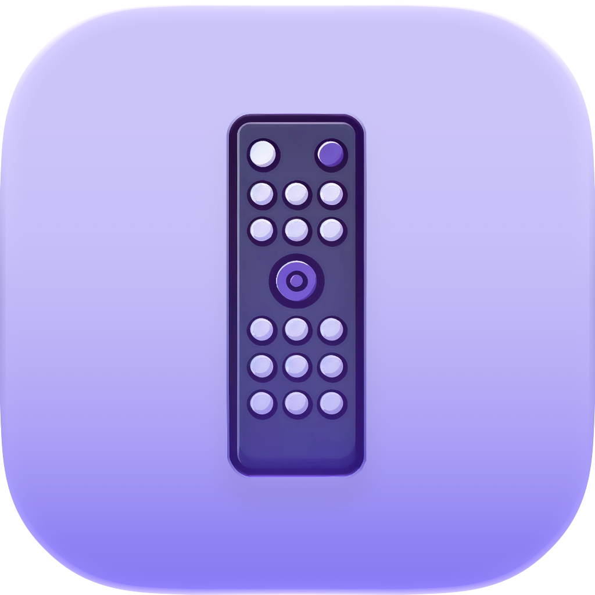
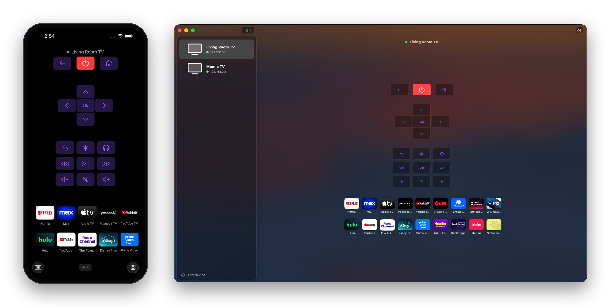

# Roam

A free Roku remote for your Apple devices, with no ads.

## Features

*   Runs on Mac, iPhone, iPad, Apple Watch and Vision Pro
*   Keyboard shortcuts on Mac, plus keyboard and volume button control on iPhone and iPad
*   Control your TV with Shortcuts, widgets or Siri without opening the app
*   Private listening on Mac, iPhone, iPad and Vision Pro (play the audio from your TV through your headphones)
*   Finds Roku devices on your local network as soon as you open the app
*   Built with Apple's native SwiftUI design system
*   Small download (8 MB on iPhone, 6 MB on Mac) and opens instantly

## How to Use

*   Open `Roam.xcodeproj` in Xcode 26 or later
*   Run on iOS, iPadOS, macOS, watchOS or visionOS

**_OR_**

*   Download it on the App Store [here](https://apps.apple.com/us/app/roam/6469834197)

## Read More

*   Blog post announcing Roam [here](https://scottdriggers.com/blog/roam-roku-remote)
*   Blog post on how I built Roam [here](https://scottdriggers.com/blog/how-i-built-roam/)
*   Blog post about the in app developer chat [here](https://scottdriggers.com/blog/discord-based-in-app-messaging)

## License

&copy; 2023 to 2026 Scott Driggers. All rights reserved.

Roam used to be open source under MIT or Apache 2.0. I changed that after
someone copied the entire app, put a $3 a week subscription in front of it,
and published it without even changing my support email. I spent a while
answering support emails from their paying customers until I got the other
developer to take it down.

Roam is now **source available**, not open source. It is licensed under the
[PolyForm Noncommercial License 1.0.0](https://polyformproject.org/licenses/noncommercial/1.0.0)
([`LICENSE.txt`](LICENSE.txt)):

*   **Free for any noncommercial purpose.** You may use, modify, distribute, and
    build on Roam for noncommercial use (personal projects, research, education,
    and noncommercial organizations), as long as you keep the `Required Notice:`
    copyright line and a copy of the license with any copies you share.
*   **Commercial use requires a separate license.** The PolyForm Noncommercial
    license does not grant any commercial use. Publishing an app based on Roam,
    redistributing it commercially, or any for profit use requires a separate
    commercial license (which may carry a fee or royalty). To get one, contact
    **scott@msd3.io**.
*   **The protocol code is free to use, even commercially.** If you want to use
    any of Roam's protocol code (the code that talks to Roku devices), email
    **roam-support@msd3.io** and I will give you written permission to use it for free,
    including in commercial projects.

Third party components bundled with Roam remain under their own licenses. The
"Roam" name, logo, and icon are trademarks of Scott Driggers and are not
licensed for reuse.

The SPDX license identifier for this project is `PolyForm-Noncommercial-1.0.0`.
